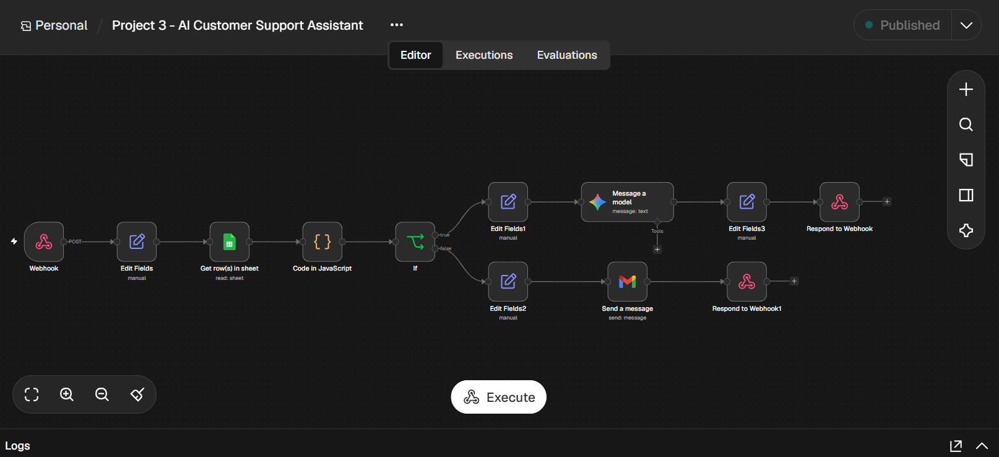

# Project 3: AI Customer Support

## 1. Project Overview

The AI Customer Support Assistant is an n8n automation workflow designed to help businesses process customer support enquiries more efficiently.
The workflow receives customer questions through a web form, analyses the enquiry using AI, and searches a predefined knowledge base for relevant information.
Based on the available information, the assistant generates a suggested response for the customer. If the enquiry cannot be resolved using the knowledge base, it is flagged for human support.
The project demonstrates how AI and workflow automation can support customer service operations while maintaining human oversight and reducing the need for repetitive manual responses.

## 2. Problem Statement
Customer support teams often receive repeated enquiries about products, services, account issues, and common operational questions.
Responding to these enquiries manually can be time-consuming and may lead to delays, inconsistent responses, and increased workload for support agents.
Some customer enquiries also require specific information that may not be readily available to the support agent, making it difficult to provide accurate responses quickly.
This project addresses these challenges by introducing an AI-powered support workflow that analyses customer enquiries and retrieves relevant information from a predefined knowledge base.

The workflow is designed to provide consistent, information-based responses while identifying enquiries that require human intervention.

## 3. Project Objectives

The objectives of this project are to:
1. Receive customer support enquiries through a web form.
2. Capture and structure customer enquiry details using an n8n Webhook.
3. Use AI to understand and categorise customer support questions.
4. Search a predefined knowledge base for relevant information.
5. Generate clear and helpful responses based on the available information.
6. Identify enquiries that cannot be resolved using the knowledge base.
7. Flag unresolved enquiries for human support.
8. Improve the efficiency and consistency of customer support operations.
9. Maintain human oversight where AI-generated responses require review.

## 4. Tools and Technologies

| Tool | Purpose |
|---|---|
| n8n | Workflow automation and integration |
| Webhook | Receives customer enquiries submitted through the web form |
| AI model | Analyses customer questions and generates suggested responses |
| Knowledge Base | Stores FAQs and support information used to answer customer enquiries |
| JavaScript | Data transformation and workflow logic |
| Web Form | Provides the interface for customers to submit support enquiries |

## 5. Workflow Design

The workflow will follow a sequential process:
1. **Web Form:** Customer submits a support enquiry with their name, email address, and question.
2. **Webhook:** n8n receives the submitted customer information.
3. **Edit Fields:** Customer details and enquiry are structured for processing.
4. **Knowledge Base Search:** The workflow searches the predefined support information for relevant answers.
5. **AI Analysis:** The AI model analyses the customer enquiry and the retrieved information.
6. **Response Generation:** The AI generates a suggested response based on the available knowledge.
7. **Escalation Check:** The workflow determines whether the enquiry can be answered or should be referred to human support.
8. **Output:** The suggested response or escalation status is returned to the appropriate destination.

The workflow is designed to avoid generating unsupported answers and to identify enquiries that require human intervention.

## 6. Workflow Implementation

The AI Customer Support Assistant was implemented in n8n as a single workflow with two possible execution paths, depending on whether the customer's enquiry matches an entry in the knowledge base.

### Step 1: Receive Customer Enquiries
A Webhook node was configured to receive customer enquiries through HTTP POST requests.
The incoming request captures three key pieces of information:
- Customer name
- Customer email
- Customer message

### Step 2: Structure Customer Information
An Edit Fields node was used to extract and organise the incoming information into structured fields:
- `customer_name`
- `customer_email`
- `customer_message`

### Step 3: Retrieve Knowledge Base Records
A Google Sheets node was configured to retrieve FAQ records from a spreadsheet named **Customer Support Knowledge Base**.
The spreadsheet contains three main columns:
- Category
- Question
- Answer
These records provide the approved information the workflow uses when responding to customer enquiries.

### Step 4: Match Customer Enquiries Against the Knowledge Base
A JavaScript Code node was introduced to compare the customer's message against the questions stored in the knowledge base.
The code extracts relevant keywords from the customer enquiry and FAQ questions, then compares them to identify the closest match.
A minimum matching score of two shared keywords is required before an FAQ is accepted as a match.

### Step 5: Introduce Conditional Routing
An IF node evaluates the matching result and determines which execution path the enquiry should follow.
The workflow has two possible paths:
**True Branch – FAQ Match Found**
When a matching FAQ is found:
1. Customer information and the matched FAQ answer are organised using an Edit Fields node.
2. Google Gemini processes the information and generates a clear, polite customer support response.
3. Another Edit Fields node extracts the generated AI response and retains the customer details.
4. A Respond to Webhook node returns the generated response.

**False Branch – No FAQ Match Found**
When no suitable FAQ is found:
1. An Edit Fields node organises the customer information and assigns the status `Requires Human Support`.
2. A Gmail node sends an escalation notification to the designated support email address.
3. A Respond to Webhook node returns the output from the Gmail operation.

### Step 6: Configure AI Response Generation
Google Gemini was configured to generate customer-friendly responses using the approved knowledge base answer.
The AI instructions restrict the model from introducing unsupported information, inventing company policies, or providing unverified contact details.
This ensures that generated responses remain grounded in the information available in the knowledge base.

### Step 7: Configure Human Escalation
The Gmail node was configured to send an email notification whenever an enquiry does not match the available FAQs.
The notification includes:
- Customer name
- Customer email
- Customer message
- Escalation status
This allows the support team to identify enquiries that require further attention.

### Step 8: Configure Webhook Responses
Respond to Webhook nodes were added to both execution paths to return workflow results to the system or application submitting the enquiry.
The FAQ-matched path returns the customer details and generated AI response, while the unmatched path returns the result of the Gmail notification operation.

The workflow was tested using PowerShell HTTP requests to simulate incoming customer enquiries.

## 7. Workflow Execution and Testing
The workflow was tested using PowerShell to simulate customer enquiries sent to the n8n Webhook through HTTP POST requests.
Two test scenarios were used to validate the workflow's decision-making, AI response generation, and human escalation functionality.

### Test Case 1: Customer Enquiry with an FAQ Match
**Test Input:**
A customer submitted the following enquiry:
"I need help resetting my account password. Can you guide me?"
**Expected Behaviour:**
- The webhook receives the customer information.
- The workflow searches the Google Sheets knowledge base.
- The JavaScript node identifies a matching FAQ.
- The IF node routes the enquiry through the True branch.
- Gemini generates a response using the approved FAQ answer.
- The webhook returns the customer details and generated response.

**Actual Result:**
The workflow successfully identified the password-reset FAQ and generated a relevant response explaining how the customer could use the "Forgot Password" option on the login page.
<badge color="success">Passed</badge>

### Test Case 2: Customer Enquiry Without an FAQ Match
**Test Input:**
A customer submitted the following enquiry:
"Can I get a discount on my annual subscription?"

**Expected Behaviour:**
- The webhook receives the customer information.
- The workflow searches the knowledge base.
- No suitable FAQ match is identified.
- The IF node routes the enquiry through the False branch.
- The enquiry is flagged for human support.
- Gmail sends an escalation notification to the designated support email address.

**Actual Result:**
The workflow successfully identified that the enquiry was not covered by the available knowledge base.
It assigned the status `Requires Human Support` and sent an email notification containing the customer's name, email address, message, and escalation status.
<badge color="success">Passed</badge>

### Testing Summary
Both test scenarios executed successfully, confirming that the workflow can distinguish between enquiries that can be answered using the available knowledge base and those that require human intervention.

## 8. Challenges and Resolutions

Several technical issues were encountered during the implementation of the AI Customer Support Assistant. These were resolved through configuration adjustments, testing, and debugging.

### 1. Google Sheets API Authentication
**Challenge:** The Google Sheets integration initially returned an error because the Google Drive API had not been enabled in the connected Google Cloud project.
**Resolution:** The Google Drive API was enabled, after which the Google Sheets node successfully connected to the knowledge base.

### 2. Knowledge Base Field Mapping
**Challenge:** The Google Sheets node returned spreadsheet columns using default field names such as `A1`, `B1`, and `C1`, rather than the expected column headers.
**Resolution:** The JavaScript code was adjusted to reference the actual output fields returned by Google Sheets.

### 3. FAQ Matching Logic
**Challenge:** The initial keyword-matching logic failed to identify some enquiries because customers could phrase questions differently from the wording used in the knowledge base.
**Resolution:** The JavaScript matching logic was improved to normalise text, remove common words, and compare shared keywords. A minimum matching score was introduced to determine whether an FAQ should be accepted.

### 4. Webhook Response Configuration
**Challenge:** The initial webhook response configuration caused issues with returning the generated AI response and customer information.
**Resolution:** The Webhook node was configured to use Respond to Webhook nodes. Response bodies were also adjusted to use expression mode and return structured JSON data.

### 5. Human Escalation Response
**Challenge:** The unmatched enquiry initially produced an empty webhook response because the False branch did not have a Respond to Webhook node.
**Resolution:** A Respond to Webhook node was added after the Gmail notification node on the False branch.

### 6. Gmail Notification Configuration
**Challenge:** The escalation process needed an email notification mechanism to alert the support team when an enquiry could not be answered using the knowledge base.
**Resolution:** A Gmail node was configured to send customer

## 9. Project Outcomes and Business Value

The AI Customer Support Assistant demonstrates how workflow automation and AI can support customer service operations by reducing repetitive manual tasks and improving the handling of customer enquiries.

### Key Outcomes
- **Automated Enquiry Capture:** Customer enquiries are received and processed automatically through an n8n webhook.
- **Knowledge Base Integration:** Google Sheets provides a central source of approved answers for frequently asked questions.
- **Automated FAQ Matching:** JavaScript-based keyword matching helps identify relevant knowledge base entries.
- **AI-Powered Response Generation:** Google Gemini transforms approved FAQ information into clear and professional customer responses.
- **Human Escalation:** Enquiries without suitable FAQ matches are flagged for human support, with email notifications sent through Gmail.
- **Structured Workflow Responses:** Respond to Webhook nodes return execution results to the requesting application.

### Business Value
The workflow demonstrates several potential business benefits:
1. **Improved Efficiency:** Reduces the manual effort required to process routine customer enquiries.
2. **Faster Response Preparation:** Helps support teams generate responses without manually searching through FAQ documents.
3. **More Consistent Communication:** Uses approved knowledge base information as the foundation for AI-generated responses.
4. **Better Enquiry Management:** Identifies enquiries that require human attention rather than treating every question as automatically answerable.
5. **Human Oversight:** Keeps support personnel involved when the available information is insufficient.
Overall, the project demonstrates how AI and automation can complement human customer support teams without completely removing human involvement from the process.

## 10. Workflow Screenshots and Resources

